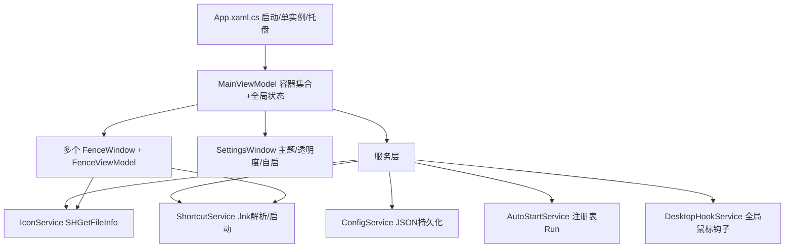

## 产品概述

一款运行于 Windows 11 的轻量级桌面图标整理工具，形态参考 Stardock Fences：用多个半透明「栅栏（Fence）」容器把杂乱的桌面图标分组归纳，让桌面整洁、简约、可一键管理。界面全简体中文，贴合 Windows 11 设计语言（圆角、毛玻璃/亚克力半透明），支持浅色/深色主题，常驻系统托盘并支持开机自启。

## 核心功能

- **栅栏容器管理**：创建/删除多个半透明带标题栏的矩形容器，可自由拖动、拉伸缩放，标题双击重命名。
- **图标拖拽归纳**：从桌面/资源管理器拖入快捷方式、文件、文件夹；容器之间、容器与桌面之间自由拖拽；双击容器内图标正常打开目标。
- **折叠（Roll-up）**：双击标题栏将容器折叠为仅标题条，再次双击展开。
- **桌面双击隐藏/显示**：双击桌面空白处一键隐藏/显示全部容器。
- **外观个性化**：调节容器背景透明度与颜色，浅色/深色主题（可跟随系统）。
- **开机自启动 + 托盘常驻**：托盘右键菜单含显示隐藏、新建容器、设置、自启开关、退出。
- **配置持久化**：容器位置/大小/名称/所含图标/外观设置本地保存，重启自动恢复布局。

## 交付物

- 完整可编译的 .NET 8 WPF 源码工程（含中文注释）。
- Inno Setup 打包脚本 + 一键构建脚本（在 Windows 上执行生成安装包）。
- README 与使用说明文档。

## 技术栈

- **语言/框架**：C# + WPF，目标框架 `net8.0-windows`（Windows 专属，Mac 侧仅静态编写与自查，不实际编译运行）。
- **MVVM**：`CommunityToolkit.Mvvm`（ObservableObject / RelayCommand），降低样板代码。
- **托盘**：`Hardcodet.NotifyIcon.Wpf`（WPF 原生托盘图标 + 上下文菜单）。
- **序列化**：`System.Text.Json`，配置落盘 `%AppData%\DesktopFences\config.json`。
- **原生能力（P/Invoke）**：
- 亚克力/毛玻璃：`DwmSetWindowAttribute` + `SetWindowCompositionAttribute`。
- 图标提取：`SHGetFileInfo`（提取文件/快捷方式图标）。
- 桌面空白双击检测：低级全局鼠标钩子 `WH_MOUSE_LL`，命中桌面（`WorkerW`/`SysListView32`）时触发隐藏/显示。
- 快捷方式解析/启动：Windows Script Host COM（`WScript.Shell`）解析 `.lnk`。
- **开机自启**：注册表 `HKCU\Software\Microsoft\Windows\CurrentVersion\Run`。
- **单实例**：命名 `Mutex` 防多开。
- **打包**：`dotnet publish`（self-contained / 单文件）+ Inno Setup 生成安装包。

## 实现思路

采用 MVVM + 服务层分层：每个栅栏为一个独立无边框透明 `FenceWindow`（置于桌面层，不抢占焦点、不显示在任务栏），由 `FenceViewModel` 驱动；全局状态（容器集合、主题、自启、可见性）由 `AppSettings` 统一管理并持久化。系统交互（鼠标钩子、图标提取、自启、快捷方式）封装为独立服务，便于复用与单测。

**关键决策与权衡**：

- 栅栏使用「每容器一个窗口」而非单一全屏覆盖窗口，便于独立拖动/缩放/折叠与 Z 序管理，避免遮挡桌面操作；代价是多窗口管理，用窗口集合统一调度。
- 图标归纳仅在容器内记录目标路径的「引用」展示，默认不物理移动桌面文件（可选物理移动留扩展），降低误删风险、提升可靠性。
- 持久化采用防抖写入（拖动/缩放结束后再落盘），避免高频 I/O。
- 全局鼠标钩子仅做双击命中判断并立即返回，保证不阻塞系统输入。

## 视觉设计（Win11 简约风）

- 无边框圆角容器 + 亚克力半透明背景，细标题栏（标题文字 + 轻量操作按钮）。
- 图标网格布局（固定格宽，自动换行，超量滚动），hover 高亮。
- 浅色/深色主题资源字典切换，透明度滑杆实时预览，整体留白克制、动效轻量。
- 全简体中文文案；默认字体 Microsoft YaHei UI / Segoe UI 回退。

## 架构图



## 目录结构

```
/Users/winkhe/code/else/
├── DesktopFences.sln                         # [NEW] 解决方案
├── README.md                                 # [NEW] 项目结构/依赖/编译/运行/打包说明
├── docs/
│   └── 使用说明.md                            # [NEW] 功能说明 + 使用指南（中文）
├── installer/
│   ├── setup.iss                             # [NEW] Inno Setup 脚本：安装目录/开始菜单/可选自启/卸载
│   └── build.ps1                             # [NEW] 一键构建：dotnet publish + 调用 ISCC 生成安装包
└── src/DesktopFences/
    ├── DesktopFences.csproj                  # [NEW] net8.0-windows WPF 工程，引用 NuGet，发布配置
    ├── App.xaml / App.xaml.cs                # [NEW] 启动入口：单实例Mutex、托盘初始化、恢复布局、主题应用
    ├── Models/
    │   ├── FenceModel.cs                     # [NEW] 栅栏：Id/标题/位置/尺寸/是否折叠/透明度/颜色/图标集合
    │   ├── FenceItemModel.cs                 # [NEW] 图标项：名称/路径/类型/图标源
    │   └── AppSettings.cs                     # [NEW] 全局设置：主题/自启/全局可见性/栅栏列表
    ├── Services/
    │   ├── ConfigService.cs                  # [NEW] JSON 读写(%AppData%)，防抖保存，异常容错
    │   ├── AutoStartService.cs               # [NEW] 注册表 Run 项读写开机自启
    │   ├── IconService.cs                    # [NEW] SHGetFileInfo 提取并缓存图标
    │   ├── ShortcutService.cs                # [NEW] .lnk 解析与目标启动，目标丢失优雅处理
    │   └── DesktopHookService.cs             # [NEW] WH_MOUSE_LL 全局钩子，检测桌面空白双击
    ├── ViewModels/
    │   ├── MainViewModel.cs                  # [NEW] 容器集合、全局显隐、新建/删除、持久化协调
    │   ├── FenceViewModel.cs                 # [NEW] 单容器状态与命令（重命名/折叠/打开/拖放）
    │   └── SettingsViewModel.cs              # [NEW] 主题切换、透明度、自启开关绑定
    ├── Views/
    │   ├── FenceWindow.xaml / .cs            # [NEW] 无边框亚克力容器窗，拖动/缩放/折叠/图标网格/滚动
    │   └── SettingsWindow.xaml / .cs         # [NEW] 设置界面
    ├── Themes/
    │   ├── Styles.xaml                       # [NEW] Win11 圆角/控件通用样式
    │   ├── Light.xaml                        # [NEW] 浅色主题资源
    │   └── Dark.xaml                         # [NEW] 深色主题资源
    └── Helpers/
        ├── Win32Interop.cs                   # [NEW] P/Invoke：亚克力、窗口样式、SHGetFileInfo、钩子
        └── TrayMenu.cs                       # [NEW] 托盘右键菜单构建与命令绑定
```

## 执行要点

- Mac 侧仅做静态编写与自查，保证代码在 Windows + .NET 8 SDK 下 `dotnet build` 可通过；所有 Win32 P/Invoke 签名与 NuGet 版本需核对准确。
- 窗口需设置 `ShowInTaskbar=false`、`WindowStyle=None`、`AllowsTransparency=true`，并处理 DPI 缩放。
- 全局钩子、COM 对象、非托管句柄需在退出时释放，防止泄漏与残留进程。
- 配置读写做异常兜底（文件损坏/缺失回退默认），避免启动崩溃。